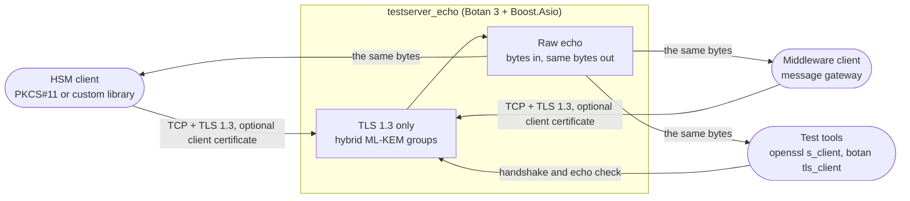
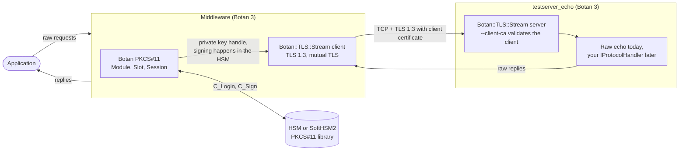
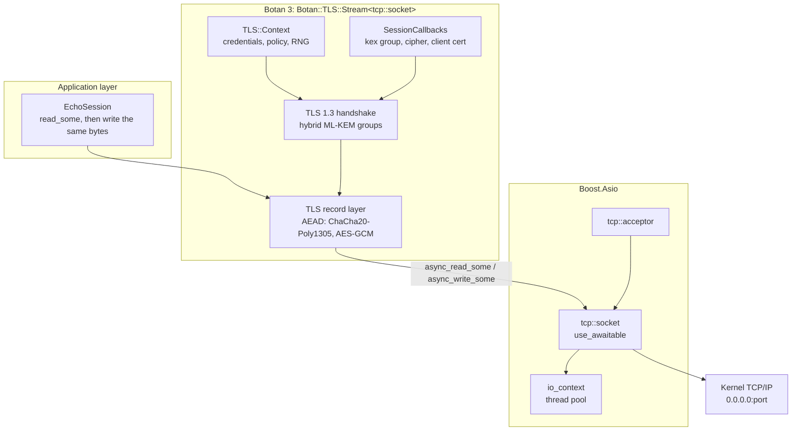
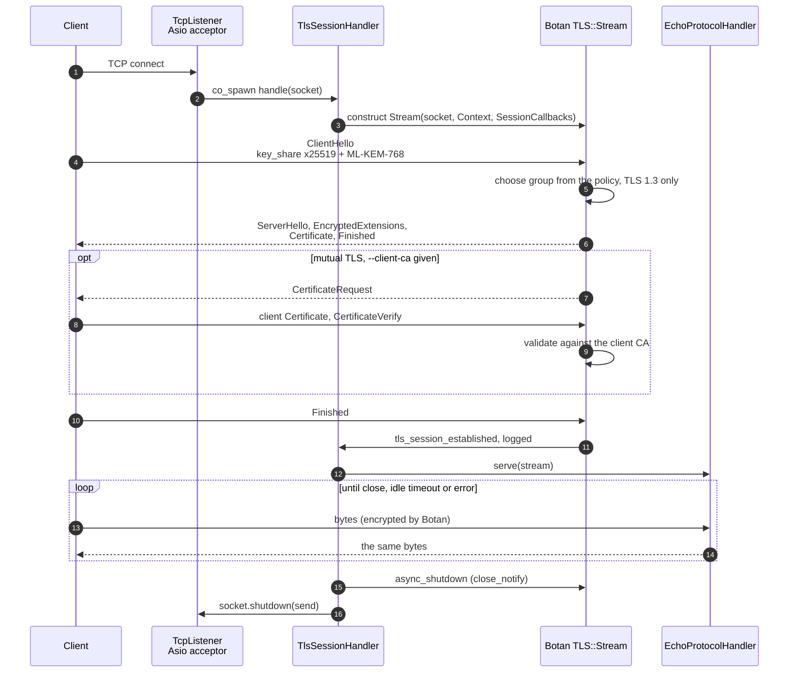
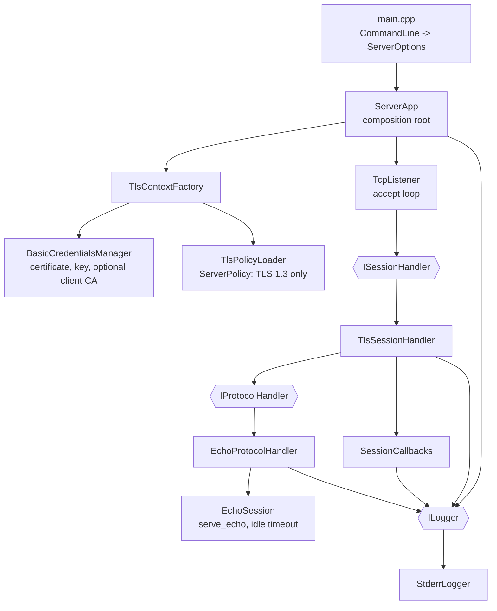
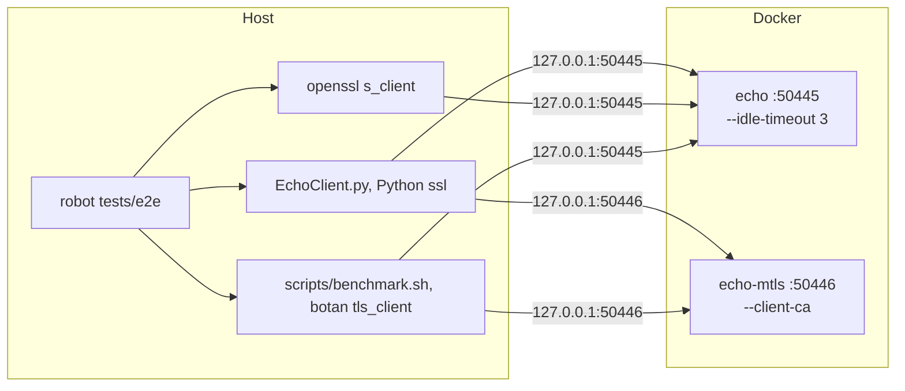

# Botan TLS 1.3 Echo Server

A raw TCP-over-TLS 1.3 echo server. Boost.Asio owns the sockets and the event
loop, [Botan's asio
stream](https://botan.randombit.net/handbook/api_ref/tls.html#tls-stream)
(`Botan::TLS::Stream`) performs TLS 1.3, and the application protocol on top is
the simplest one there is: every byte received is sent back unchanged.

It is the minimal "application server over TLS 1.3" skeleton for software that
talks a custom binary protocol over a socket, such as an HSM client, a
communications middleware or a message gateway. Use it to check that your
client can complete a TLS 1.3 handshake (including the post-quantum hybrid key
exchange) and that its bytes survive the round trip. To build a real service,
replace the echo handler with your own `IProtocolHandler`.

This is the sibling of the [HTTP/2
server](https://github.com/jgmatu/botan-tls-testserver-http2) and shares its
structure: small classes behind interfaces, wired together in one place, with
GoogleTest/GoogleMock unit tests.

## Use case



What it gives you:

- TLS **1.3 only**. TLS 1.2 is refused whatever the policy file says.
- Key exchange from a Botan policy file, including the hybrid
  `x25519/ML-KEM-768` group. The server logs the group, the cipher suite and the
  client certificate of every connection.
- **Mutual TLS** (client certificates) when you pass `--client-ca`.
- A raw byte stream: no framing, no parsing, no limit on message size.
- An idle timeout (`--idle-timeout`, default 60 s) that closes silent clients.

## Using it as a raw HSM-style service

This is the intended way to use the server: as the stand-in for a remote
application server that speaks a raw binary protocol over TLS 1.3, such as an
HSM gateway, while Botan 3 also provides the PKCS#11 part of the middleware.

Two different links are involved, and Botan 3 covers both:

- **PKCS#11** is the *local* API between the middleware and the HSM (or a
  software token such as SoftHSM2). Keys stay inside the HSM and signatures are
  made there (`C_Sign`).
- **TLS 1.3** is the *network* link between the middleware (or any client) and
  the remote service. This server terminates it and, for now, echoes the bytes.



What the echo gives you at this stage: a server that behaves like the remote
service at the transport level (TLS 1.3, post-quantum hybrid key exchange,
client certificates, any binary payload, many simultaneous connections), so you
can develop and measure the middleware before the real protocol exists.

### 1. Run the server with mutual TLS

The middleware authenticates with a certificate whose private key is in the HSM,
so start the server with `--client-ca` (see [Mutual TLS](#mutual-tls) for the
certificates):

```bash
build/testserver_echo --cert certs/server.pem --key certs/server.key --port 50445 \
   --policy policies/tls13_pqc.txt --client-ca certs/ca.pem
```

The client certificate whose private key lives in the HSM must be signed by that
CA. Create the certificate request with your HSM tooling (for SoftHSM2,
`softhsm2-util` and `pkcs11-tool` or `openssl` with a PKCS#11 provider), sign it
with `botan sign_cert`, and keep only the certificate as a PEM file for the
middleware. The key itself never leaves the token.

### 2. The middleware client with Botan 3

Botan's `Credentials_Manager` is where the HSM comes in: `private_key_for`
returns a `PKCS11_ECDSA_PrivateKey` (or `PKCS11_RSA_PrivateKey`) instead of a key
loaded from a file, and Botan asks the HSM to sign the TLS 1.3 `CertificateVerify`.

```cpp
#include <botan/certstor.h>
#include <botan/credentials_manager.h>
#include <botan/data_src.h>
#include <botan/p11_ecdsa.h>
#include <botan/p11_object.h>
#include <botan/p11_types.h>
#include <botan/x509cert.h>

/// Client credentials: the certificate is a PEM file, the private key never leaves the HSM.
class HsmClientCredentials final : public Botan::Credentials_Manager {
   public:
      HsmClientCredentials(const std::string& pkcs11_module,
                           const std::string& pin,
                           const std::string& key_label,
                           const std::string& client_certificate_pem,
                           const std::string& ca_pem) :
            module_(pkcs11_module),
            slot_(module_, Botan::PKCS11::Slot::get_available_slots(module_, true).at(0)),
            session_(slot_, true),
            ca_(Botan::X509_Certificate(ca_pem)) {
         session_.login(Botan::PKCS11::UserType::User, Botan::PKCS11::secure_string(pin.begin(), pin.end()));

         Botan::PKCS11::AttributeContainer wanted(Botan::PKCS11::ObjectClass::PrivateKey);
         wanted.add_string(Botan::PKCS11::AttributeType::Label, key_label);
         const Botan::PKCS11::ObjectFinder finder(session_, wanted.attributes());
         key_ = std::make_shared<Botan::PKCS11::PKCS11_ECDSA_PrivateKey>(session_, finder.find().at(0));

         Botan::DataSource_Stream crt(client_certificate_pem);
         chain_.push_back(Botan::X509_Certificate(crt));
      }

      std::vector<Botan::Certificate_Store*> trusted_certificate_authorities(const std::string&,
                                                                             const std::string&) override {
         return {&ca_};  // the CA that signed the server certificate
      }

      std::vector<Botan::X509_Certificate> find_cert_chain(const std::vector<std::string>& key_types,
                                                           const std::vector<Botan::AlgorithmIdentifier>&,
                                                           const std::vector<Botan::X509_DN>&,
                                                           const std::string&,
                                                           const std::string&) override {
         for(const auto& type : key_types) {
            if(type == key_->algo_name()) {
               return chain_;
            }
         }
         return {};
      }

      std::shared_ptr<Botan::Private_Key> private_key_for(const Botan::X509_Certificate&,
                                                          const std::string&,
                                                          const std::string&) override {
         return key_;  // signing happens inside the HSM (C_Sign)
      }

   private:
      Botan::PKCS11::Module module_;
      Botan::PKCS11::Slot slot_;
      Botan::PKCS11::Session session_;
      Botan::Certificate_Store_In_Memory ca_;
      std::vector<Botan::X509_Certificate> chain_;
      std::shared_ptr<Botan::PKCS11::PKCS11_ECDSA_PrivateKey> key_;
};
```

With those credentials the middleware connects like any other client of this
server, and sends its raw frames:

```cpp
#include <boost/asio/connect.hpp>
#include <boost/asio/io_context.hpp>
#include <boost/asio/ip/tcp.hpp>
#include <boost/asio/read.hpp>
#include <boost/asio/write.hpp>

#include <botan/asio_context.h>
#include <botan/asio_stream.h>
#include <botan/auto_rng.h>
#include <botan/tls_policy.h>
#include <botan/tls_session_manager_noop.h>

std::string call_server(const std::string& host, const std::string& port, const std::string& request) {
   namespace net = boost::asio;

   auto credentials = std::make_shared<HsmClientCredentials>(
      "/usr/lib/softhsm/libsofthsm2.so", "1234", "client-key", "certs/client.pem", "certs/ca.pem");
   auto policy = std::make_shared<Botan::TLS::Text_Policy>("allow_tls12 = false\nrequire_cert_revocation_info = false\n");
   auto context = std::make_shared<Botan::TLS::Context>(credentials,
                                                        std::make_shared<Botan::AutoSeeded_RNG>(),
                                                        std::make_shared<Botan::TLS::Session_Manager_Noop>(),
                                                        policy,
                                                        Botan::TLS::Server_Information(host, 0));

   net::io_context io;
   Botan::TLS::Stream<net::ip::tcp::socket> stream(context, io);
   net::connect(stream.next_layer(), net::ip::tcp::resolver(io).resolve(host, port));
   stream.handshake(Botan::TLS::Connection_Side::Client);  // CertificateVerify is signed inside the HSM

   net::write(stream, net::buffer(request));
   std::string reply(request.size(), '\0');
   net::read(stream, net::buffer(reply));  // the echo: same bytes back
   return reply;
}
```

Build notes:

- Botan must have the `pkcs11` module. The Botan installed by
  `3rdparty/install.sh` has it (`BOTAN_HAS_PKCS11` in `botan/build.h`).
- `botan/p11.h` includes the PKCS#11 headers as `<pkcs11.h>`. Botan installs them
  next to its own headers, but do **not** add `include/botan-3/botan` to the
  include path: it contains Botan's `assert.h`, which then shadows the system one
  and breaks Boost. Expose only the three PKCS#11 headers instead:

  ```cmake
  file(MAKE_DIRECTORY ${CMAKE_BINARY_DIR}/pkcs11-include)
  foreach(h pkcs11.h pkcs11t.h pkcs11f.h)
     file(CREATE_LINK /usr/local/include/botan-3/botan/${h} ${CMAKE_BINARY_DIR}/pkcs11-include/${h} SYMBOLIC)
  endforeach()
  target_include_directories(middleware PRIVATE ${CMAKE_BINARY_DIR}/pkcs11-include)
  ```

- The PKCS#11 library path, PIN and key label above are examples. For a test
  token, SoftHSM2 (`apt install softhsm2`) is enough; for a real HSM use the
  vendor's PKCS#11 library.
- The snippets compile against Botan 3.14 and Boost, but were not run against a
  token: there is no HSM or SoftHSM2 in this repository's test setup. The unit
  tests of this repository use a Botan client with the key in a PEM file.

### 3. Check the connection and measure it

First check by hand that the server accepts the certificate and echoes:

```bash
botan tls_client localhost --port=50445 --policy=policies/tls13_pqc.txt --trusted-cas=certs/ca.pem \
   --client-cert=certs/client.pem --client-cert-key=certs/client.key
```

Then load it with `scripts/benchmark.sh`, passing the same client certificate
(see [Benchmark](#benchmark)):

```bash
scripts/benchmark.sh --port 50445 --ca certs/ca.pem \
   --client-cert certs/client.pem --client-key certs/client.key \
   --clients 50 --rounds 20 --lines 200 --line-size 80
```

The server logs `client_cert=CN="client"` for each authenticated connection, and
the script checks that every client got back exactly the text it sent. A server
without `--client-ca` takes the same command without the two client options.

The script uses `botan tls_client`, which reads its client key from a PEM file, so
the benchmark measures the network and TLS side with a file key. It does not
exercise the HSM. To measure the cost of signing in the HSM, time
`call_server` from step 2 in a loop in your middleware: in TLS 1.3 the HSM signs
once per handshake, so it shows up in the handshake latency and not in the echo
round trips.

### 4. From echo to the real protocol

When the real protocol exists, keep the TLS and transport code and replace only
the application part: implement `IProtocolHandler::serve(TlsStream&)` (for
example a length-prefixed request and response loop for HSM commands), build it in
`ServerApp` instead of `EchoProtocolHandler`, and the middleware and the benchmark
keep working against it. The server's own private key can come from an HSM in the
same way as the client's: return a PKCS#11 key from
`BasicCredentialsManager::private_key_for`.

## Architecture

### Network stack



### Connection lifecycle

One accepted TCP connection is one coroutine, from accept to the TLS shutdown.



A client that disappears without `close_notify`, or that resets the connection,
is a normal end of the connection and is not logged as an error. A failed
handshake (for example a TLS 1.2 only client, or a missing client certificate)
is logged with its TLS alert.

### Components

Everything except `main.cpp` is in the static library `testserver_echo_core`,
which the tests link. The hexagons are interfaces that the tests replace with
GoogleMock mocks.



| Directory | Responsibility |
|---|---|
| `src/common` | `ILogger`, `StderrLogger`, benign-disconnect detection, cancelling pending I/O |
| `src/pkcs11` | Loading the PKCS#11 library and `C_Initialize`, the starting point for keys in an HSM |
| `src/tls` | Credentials (server chain and key, client CA), TLS 1.3-only `ServerPolicy`, policy loading, negotiated-session logging |
| `src/server` | Command line, TLS context creation, TCP accept loop, TLS session handler, echo protocol handler, `ServerApp` |
| `src/echo` | `serve_echo`: the echo loop with its idle timeout, generic over any async stream |
| `policies` | Botan TLS policy files |
| `tests/unit` | GoogleTest/GoogleMock tests and a blocking TLS test client |
| `tests/e2e` | Robot Framework suites against the server in Docker |
| `tests/fixtures` | Test certificates, shared by the unit and end-to-end tests |

To serve something other than an echo, implement `IProtocolHandler::serve` and
pass it to `TlsSessionHandler` in `ServerApp`.

## Build

Install the latest Botan 3 and Boost into `/usr/local` (the script uses `sudo`
when it is not already root):

```bash
./3rdparty/install.sh
cmake -B build -S .
cmake --build build
```

The install script also installs GoogleTest and GoogleMock (`libgtest-dev`,
`libgmock-dev`) with apt, which the unit tests need. Pass `-DBUILD_TESTING=OFF`
to `cmake` to build without them.

To build a container image instead, without installing anything on the host:

```bash
docker build -t testserver_echo .
docker run --rm -p 50445:50445 -v "$PWD/certs:/certs:ro" --user "$(id -u):$(id -g)" testserver_echo \
   --port 50445 --cert /certs/server.pem --key /certs/server.key --policy policies/tls13_pqc.txt
```

## Tests

There are two kinds of tests. The unit tests in `tests/unit` are built by
CMake and run in one process on the host. The end-to-end tests in `tests/e2e`
run the real server in Docker and talk to it from the host.

### Unit tests

```bash
ctest --test-dir build --output-on-failure
```

The unit tests cover the echo loop (binary data, 1 MiB streams, idle timeout, abrupt
disconnects), the command line, the policies, the TCP accept loop, the session
handler with a mocked protocol handler, and the whole stack with a real Botan
TLS client over loopback: TLS 1.3 echo, hybrid and classical key exchange,
rejection of TLS 1.2 clients, and mutual TLS with and without a client
certificate. `tests/fixtures` holds a throw-away CA, server and client
certificate generated with the Botan CLI (valid for ten years). They are for
the tests only.

### End-to-end tests

```bash
scripts/run-e2e.sh                         # all suites
scripts/run-e2e.sh --exclude benchmark     # without the load test
scripts/run-e2e.sh --include benchmark --variable BENCH_CLIENTS:100
```

The script installs Robot Framework into `.venv` and runs `robot` on
`tests/e2e`. Any extra arguments go to `robot`. `tests/e2e/__init__.robot`
builds the image and starts the containers before the suites, and stops them
afterwards:



- The image is built by the `Dockerfile` in the repository root. Its first
  stage builds Boost and Botan with `3rdparty/install.sh`, which takes 15 to 25
  minutes the first time. Docker caches that stage, so later runs only rebuild
  the server.
- `tests/e2e/docker-compose.yml` starts two containers from that image, with
  `tests/fixtures` mounted read-only at `/certs`. Their ports are published on
  `127.0.0.1` only.
- The clients run on the host, so every request crosses the Docker port
  mapping.

| Suite | Tag | Container | Checks |
|---|---|---|---|
| `echo.robot` | `functional` | `echo` | TLS 1.3 handshake, text, 1 MiB binary, `X25519MLKEM768`, TLS 1.2 refused, idle timeout, 50 concurrent clients |
| `mtls.robot` | `mtls` | `echo-mtls` | Echo with a client certificate, refusal without one, concurrent mutual TLS clients |
| `benchmark.robot` | `benchmark` | both | `scripts/benchmark.sh` with and without client certificates, every client must get its text back |

The results go to `build/e2e-results`: Robot's `report.html` and `log.html`,
plus `docker-compose.log` with the logs of both containers. You need Docker
with Compose v2 (usable without `sudo`) and Python 3. The hybrid group test
needs OpenSSL 3.5 or newer on the host. The benchmark needs `botan` in the
`PATH`, and its tests are skipped without it. The documentation of
`tests/e2e/__init__.robot` describes the setup in more detail and shows up in
`log.html`.

## Benchmark

`scripts/benchmark.sh` loads a running server with ASCII text, using Botan's own
TLS client (`botan tls_client`). It starts N concurrent clients; each opens one
TLS 1.3 connection, waits for the handshake, then sends text and waits for the
same bytes to come back, for a number of rounds. All connections are served at
the same time by the server's coroutines. `tests/e2e/benchmark.robot` runs it
against the server in Docker (see [End-to-end tests](#end-to-end-tests)).

```bash
scripts/benchmark.sh --port 50445 --ca certs/ca.pem --clients 50 --rounds 20 --lines 200 --line-size 80
```

| Option | Default | Meaning |
|---|---|---|
| `--port` | required | Echo server port |
| `--host` | `localhost` | Server name, must match the certificate |
| `--ca` | `certs/ca.pem` | CA that signed the server certificate |
| `--policy` | `policies/tls13_pqc.txt` | Botan policy for the clients |
| `--client-cert`, `--client-key` | none | Client certificate and key (PEM), for a server run with `--client-ca` |
| `--clients` | `10` | Concurrent clients, one TLS connection each |
| `--rounds` | `10` | Send-and-wait rounds per client |
| `--lines`, `--line-size` | `100`, `64` | Size of the ASCII text sent each round |
| `--timeout` | `30` | Seconds before a handshake or round counts as failed |
| `--keep` | off | Keep the working files (client output and results) |

It prints handshake latency, echo round-trip latency (min, average, p50, p95,
max in ms), connections and rounds per second and throughput, and checks that
every client received exactly the text it sent. The exit code is non-zero if
any client failed.

```text
  clients ok:        100 / 100
  handshake (ms):    min 154   avg 295.4   p50 296   p95 393   max 422
  echo round (ms):   min 18   avg 134.5   p50 130   p95 201   max 430
  connections/s:     52.6
  rounds/s:          525.8
  echoed:            16000000 bytes (8.02 MiB/s, same again in the other direction)
```

Every client is a separate `botan` process, so the client side usually limits
the result before the server does, and the numbers include the startup of those
processes. Compare runs on the same machine, and use the latency percentiles
rather than the totals. Needs `bash` 5, `stdbuf`, `awk` and `botan` in the
path.

## Run

You need a certificate for the server. If you don't have one, you can create a
basic certificate with Botan's CLI tool (`/usr/local/bin/botan`). From the
repository's root run:

```bash
mkdir certs

botan keygen --algo=ECDSA --params=secp384r1 --output=certs/ca.key
botan keygen --algo=ECDSA --params=secp384r1 --output=certs/server.key
botan gen_self_signed --ca --country=DE --dns=localhost --hash=SHA-384 --output=certs/ca.pem certs/ca.key localhost
botan gen_pkcs10 --output=certs/server.req certs/server.key localhost
botan sign_cert --output=certs/server.pem certs/ca.pem certs/ca.key certs/server.req
```

Start the server:

```bash
build/testserver_echo --cert certs/server.pem --key certs/server.key --port 50445 --policy policies/tls13_pqc.txt
```

| Option | Default | Meaning |
|---|---|---|
| `--port` | required | TLS 1.3 echo listen port |
| `--cert` | required | Server certificate chain (PEM) |
| `--key` | required | Server private key (PEM) |
| `--policy` | `default` | Botan policy file. TLS 1.3 is forced either way |
| `--client-ca` | none | PEM file with the CAs trusted for client certificates. Turns on mutual TLS |
| `--idle-timeout` | `60` | Seconds of silence before a connection is closed, `0` for never |
| `--pkcs11-module` | none | PKCS#11 library to load at startup. Only `C_Initialize` is called for now; the TLS key still comes from `--key` |

Policies:

- `policies/tls13_pqc.txt` offers `x25519/ML-KEM-768` first, then `ML-KEM-768`
  and classical groups. A client without ML-KEM falls back to `x25519`.
- `policies/pqc_basic.txt` is ML-KEM only, for Botan clients.
- Revocation information (OCSP or CRL) is not required of client certificates
  unless the policy file sets `require_cert_revocation_info = true`.

### Try it

```bash
# Type a line, the server sends it back
openssl s_client -tls1_3 -connect 127.0.0.1:50445 -CAfile certs/ca.pem -servername localhost

# Ask for the hybrid post-quantum group (OpenSSL 3.5 or newer)
openssl s_client -tls1_3 -groups X25519MLKEM768 -connect 127.0.0.1:50445 -CAfile certs/ca.pem

# TLS 1.2 is refused: "tlsv1 alert protocol version"
openssl s_client -tls1_2 -connect 127.0.0.1:50445 -CAfile certs/ca.pem

# The same with Botan's CLI
botan tls_client localhost --port=50445 --policy=policies/tls13_pqc.txt --trusted-cas=certs/ca.pem
```

The server prints one line per connection, for example:

```text
TLS established: 127.0.0.1:47754 TLS v1.3 kex=x25519/ML-KEM-768 cipher=CHACHA20_POLY1305_SHA256 client_cert=none
echo finished: 11 bytes
```

### Mutual TLS

Create a client certificate signed by the same CA and start the server with
`--client-ca`:

```bash
botan keygen --algo=ECDSA --params=secp384r1 --output=certs/client.key
botan gen_pkcs10 --output=certs/client.req certs/client.key client
botan sign_cert --output=certs/client.pem certs/ca.pem certs/ca.key certs/client.req

build/testserver_echo --cert certs/server.pem --key certs/server.key --port 50445 \
   --policy policies/tls13_pqc.txt --client-ca certs/ca.pem

openssl s_client -tls1_3 -connect 127.0.0.1:50445 -CAfile certs/ca.pem \
   -cert certs/client.pem -key certs/client.key
```

A client without a certificate, or with one from another CA, is refused during
the handshake and the server logs the TLS alert (`certificate_required` or
`bad_certificate`). With a valid certificate the log line shows its subject in
`client_cert=`.
