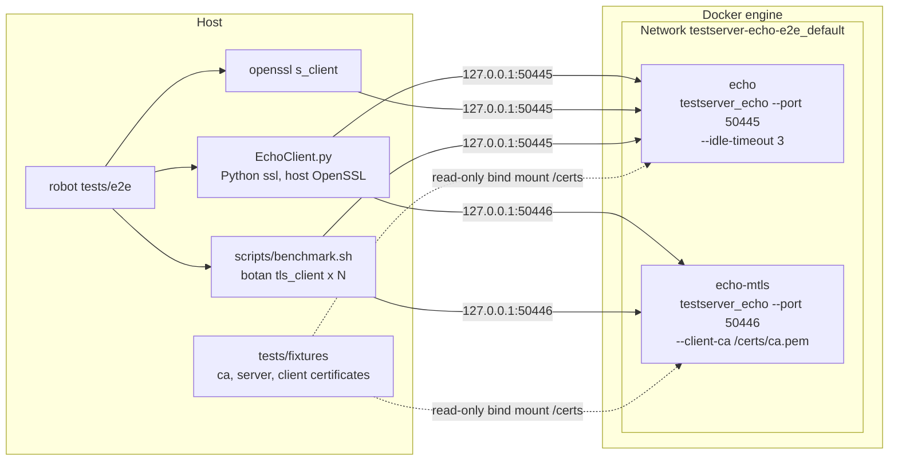
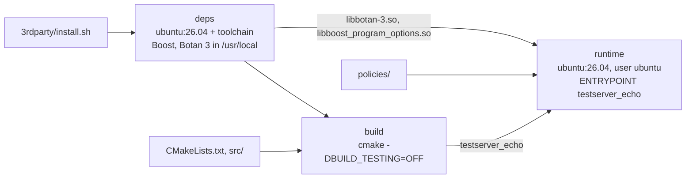
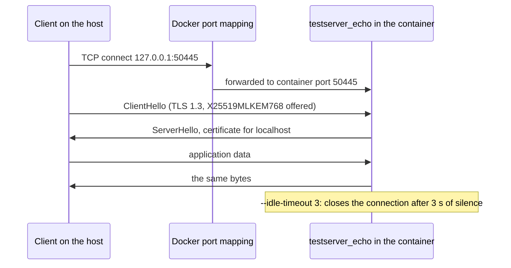
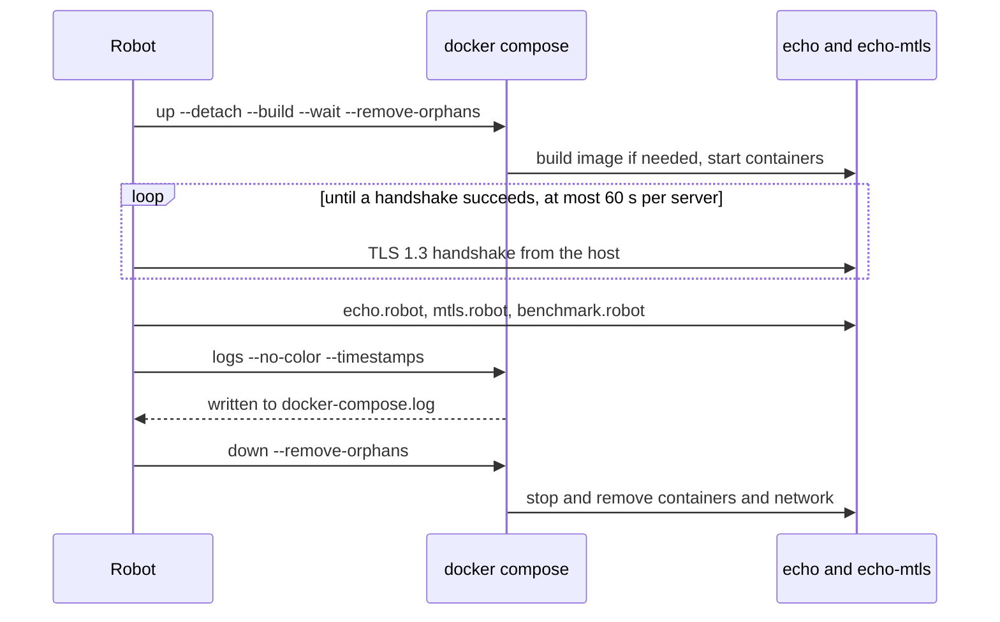

# End-to-end tests

Robot Framework suites that test the real TLS 1.3 echo server. The server
runs in Docker and every request comes from the host, so these tests cover
what the unit tests in `tests/unit` do not: the image, the command line of a
deployed server, the Docker port mapping, and clients that are not Botan.

```bash
scripts/run-e2e.sh                         # all suites
scripts/run-e2e.sh --exclude benchmark     # without the load test
scripts/run-e2e.sh --include mtls          # one tag only
scripts/run-e2e.sh --include benchmark --variable BENCH_CLIENTS:100 --variable BENCH_ROUNDS:50
```

`scripts/run-e2e.sh` creates `.venv` in the repository root, installs
`requirements.txt` and runs `robot --outputdir build/e2e-results tests/e2e`.
Extra arguments go to `robot`.

## Virtualization

### Overview



Both containers run the same image, `testserver_echo:e2e`, with different
options:

| Service | Host port | Server options | Used by |
|---|---|---|---|
| `echo` | `127.0.0.1:50445` | `--policy policies/tls13_pqc.txt --idle-timeout 3` | `echo.robot`, `benchmark.robot` |
| `echo-mtls` | `127.0.0.1:50446` | `--policy policies/tls13_pqc.txt --client-ca /certs/ca.pem` | `mtls.robot`, `benchmark.robot` |

The ports are published on `127.0.0.1` only, so the servers cannot be reached
from the network. Both use `--cert /certs/server.pem --key /certs/server.key`.

### Image

[docker/Dockerfile](../../docker/Dockerfile) builds the image with the
repository root as build context.
[docker/Dockerfile.dockerignore](../../docker/Dockerfile.dockerignore) limits
that context to `3rdparty/install.sh`, `CMakeLists.txt`, `src/` and
`policies/`.



- `deps` depends only on the install script, so Docker caches it. It takes
  some minutes the first time (Boost and Botan are compiled from source) and
  is reused until `3rdparty/install.sh` changes.
- `build` compiles the server without the unit tests. It runs again whenever
  `src/` or `CMakeLists.txt` change.
- `runtime` has no compiler and no headers: just the binary, the two shared
  libraries and `policies/`, about 225 MB.

Nothing is built or installed on the host for the server. Docker is the only
thing it needs.

### Certificates and user

`tests/fixtures` (the same throw-away certificates as the unit tests) is
mounted read-only at `/certs`:

| File | Used by |
|---|---|
| `server.pem`, `server.key` | Both servers. Issued for `localhost`, so clients connect to `127.0.0.1` and send `localhost` as server name |
| `ca.pem` | The clients, to verify the server, and `echo-mtls`, to verify client certificates |
| `client.pem`, `client.key` | The clients in `mtls.robot` and the mutual TLS benchmark |

The key files can only be read by their owner. The containers therefore run
as the host user: `resources/e2e.resource` passes `E2E_UID` and `E2E_GID`
(the ids of the user running Robot) to `docker compose`, and the compose file
sets `user: "${E2E_UID}:${E2E_GID}"`.

### Request path

Every test request starts on the host:



The server logs every handshake and every closed connection to stderr. The
`TLS 1.2 Client Is Refused` test reads those logs with `docker compose logs`
to check that the refusal is logged with its alert.

The host has three kinds of clients:

| Client | Library | Used for |
|---|---|---|
| `libraries/EchoClient.py` | Python `ssl`, that is the host's OpenSSL | Functional and mutual TLS tests, concurrent connections |
| `openssl s_client` | OpenSSL 3.5 or newer | Checking that `X25519MLKEM768` is negotiated |
| `scripts/benchmark.sh` | `botan tls_client`, one process per connection | Load test |

### Lifecycle

[__init__.robot](__init__.robot) owns the containers. It runs once around all
the suites in this directory:



`Suite Teardown` runs even when a test fails, so no container is left behind.
To run only some tests, keep `tests/e2e` as the path and choose tests with
`--include`, `--exclude` or `--test`. Running a single `.robot` file skips
`__init__.robot`, so no container would be started.

## Suites

| Suite | Tag | Container | Checks |
|---|---|---|---|
| [echo.robot](echo.robot) | `functional` | `echo` | TLS 1.3 negotiated, text and 1 MiB binary echo, several messages on one connection, `X25519MLKEM768` with `openssl s_client` (tag `pqc`), TLS 1.2 refused and logged, idle timeout, 50 concurrent clients |
| [mtls.robot](mtls.robot) | `mtls` | `echo-mtls` | Echo of text and binary data with a client certificate, refusal without one, 20 concurrent mutual TLS clients |
| [benchmark.robot](benchmark.robot) | `benchmark` | both | `scripts/benchmark.sh` with and without client certificates. Passes when every client gets back exactly what it sent; the latencies and throughput become the test message |

The benchmark load can be changed with `--variable`:

| Variable | Default | Meaning |
|---|---|---|
| `BENCH_CLIENTS` | `20` | Concurrent `botan tls_client` processes |
| `BENCH_ROUNDS` | `10` | Send-and-wait rounds per client |
| `BENCH_LINES`, `BENCH_LINE_SIZE` | `100`, `64` | Text sent each round |
| `BENCH_TIMEOUT` | `30` | Seconds before a handshake or round counts as failed |

The benchmark numbers include the startup of the client processes and the
Docker port mapping. Compare runs on the same machine.

## Files

| Path | Content |
|---|---|
| `__init__.robot` | Starts and stops the containers; its documentation summarizes this file in `log.html` |
| `echo.robot`, `mtls.robot`, `benchmark.robot` | The suites |
| `resources/e2e.resource` | Ports, paths, `docker compose` keywords |
| `libraries/EchoClient.py` | TLS client keywords on top of Python's `ssl` |
| `requirements.txt` | Robot Framework |
| `../../docker/docker-compose.yml` | The two services |
| `../../docker/Dockerfile` | The image |

## Requirements

- Docker with Compose v2 (`docker compose`), usable without `sudo`.
- Python 3 with `venv`.
- OpenSSL 3.5 or newer on the host, for the `pqc` test.
- `botan` in the `PATH` (or `/usr/local/bin/botan`), `bash` 5, `stdbuf` and
  `awk` for `benchmark.robot`. Without `botan` its tests are skipped.
- Ports 50445 and 50446 free on the host.

## Results

`build/e2e-results` (override with `E2E_OUTPUT_DIR`) contains:

- `report.html` and `log.html`: Robot's report and detailed log.
- `output.xml`: the machine-readable result, for CI.
- `docker-compose.log`: stdout and stderr of both servers, with timestamps.

## Troubleshooting

- **Port already allocated**: another server or an old run uses 50445 or
  50446. Run `docker compose -f docker/docker-compose.yml down` and stop the
  other server.
- **Permission denied on `/certs/server.key`**: the fixtures belong to a
  different user than the one running Robot. Run Robot as their owner.
- **Force a fresh image**: `docker compose -f docker/docker-compose.yml build --no-cache`.
